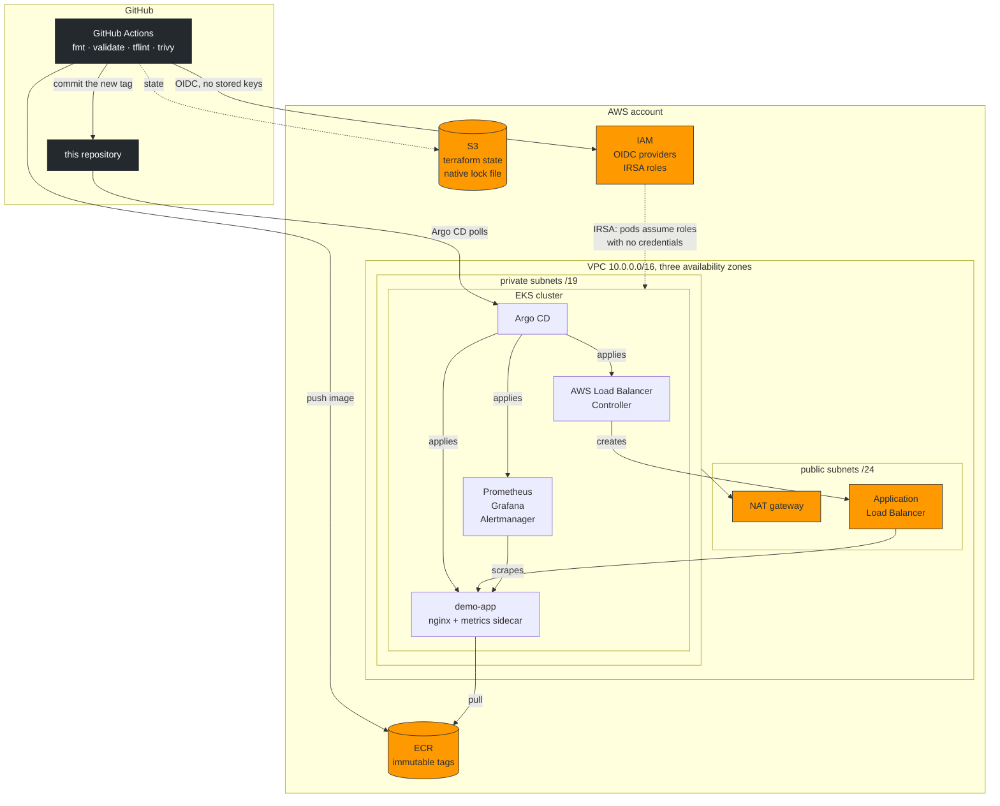

# AWS EKS, Terraform, GitOps and monitoring

A production-shaped AWS platform built from scratch: a multi-AZ VPC, a private
EKS cluster, ECR, GitHub Actions authenticating with OIDC instead of access
keys, Argo CD reconciling the cluster from this repository, and a Prometheus
and Grafana stack with real alert rules.

Every design decision that is not obvious is explained **in the file it affects**,
next to the code, including the ones that are a trade-off rather than a
best practice. The point of this repository is to be read, not just run.

---

## Architecture



**The important line in that diagram is the one that is missing.** Nothing goes
from GitHub Actions to the cluster. CI can write to a git repository and to a
container registry; it holds no kubeconfig and no cluster credential. Argo CD
pulls. That is the difference between GitOps and a pipeline that runs `kubectl
apply`, and it means a compromised workflow cannot deploy to the cluster.

---

## What is here

| Requirement | Where | Notes |
|---|---|---|
| VPC, multi-AZ, public and private subnets | [`terraform/modules/vpc`](terraform/modules/vpc) | `/19` private subnets because the VPC CNI gives every pod a real VPC IP |
| Routing, NAT, security groups | same | one NAT by default, S3 gateway endpoint to keep image pulls off it |
| EKS cluster and IAM roles | [`terraform/modules/eks`](terraform/modules/eks) | access entries, not `aws-auth`; secrets encrypted with a CMK |
| ECR | [`terraform/modules/ecr`](terraform/modules/ecr) | immutable tags, scan on push, lifecycle policy |
| Reusable modules | [`terraform/modules`](terraform/modules) | five modules, each with its own README |
| Remote state and locking | [`terraform/bootstrap`](terraform/bootstrap) | S3 with `use_lockfile`, **no DynamoDB table** |
| GitHub Actions, fmt, validate, security | [`.github/workflows/ci.yml`](.github/workflows/ci.yml) | runs the same script you run locally |
| AWS auth by OIDC, not keys | [`terraform/modules/iam-github-oidc`](terraform/modules/iam-github-oidc) | three roles, each scoped to one job |
| GitOps | [`kubernetes/argocd`](kubernetes/argocd) | app of apps, sync waves, AppProject |
| Monitoring | [`kubernetes/argocd/applications/20-monitoring.yaml`](kubernetes/argocd/applications/20-monitoring.yaml) | kube-prometheus-stack, four alerts, a dashboard in git |
| Security | [`docs/09-interview-notes.md`](docs/09-interview-notes.md) | IRSA, IMDSv2, Pod Security Admission, read-only root filesystem |
| Deployment and teardown | [`scripts/`](scripts) + [`docs/`](docs) | teardown deletes the load balancers **first**, see below |
| Troubleshooting | [`docs/07-troubleshooting.md`](docs/07-troubleshooting.md) | fourteen real failures, each with the symptom, the cause and the fix |

---

## Verified, not claimed

```
$ make validate

== Terraform ==
  PASS  terraform fmt (whole tree)
  PASS  terraform init/validate  bootstrap, envs/dev, and all 5 modules
  PASS  tflint --recursive                    (with the AWS ruleset)
  PASS  trivy config (HIGH, CRITICAL)
  PASS  IAM policy JSON is well formed
== Kubernetes manifests ==
  PASS  every YAML parses
  PASS  kustomize build
  PASS  kustomize rewrote the app image
  PASS  kubeconform  rendered demo-app        (against real schemas, CRDs included)
  PASS  kubeconform  argocd and platform
  PASS  Grafana dashboard JSON is valid and non-empty
  PASS  sync waves are ordered
== Documentation ==
  PASS  every relative link and docs/ reference resolves
== Helm charts (rendered at pinned versions) ==
  PASS  helm template every pinned chart with its Application values
== Container image ==
  PASS  image builds and serves correctly

28 passed
```

None of that needs an AWS account, and **it all ran before this repository was
published**. Two of those checks are there because they caught something real
while this was being written:

- The Helm check does not just render the charts, it asserts that each value
  actually took effect in the output. None of these three charts ships a
  `values.schema.json`, so Helm accepts an unknown key silently. That check
  found a `metrics-server` values block that was launching the container with
  `--kubelet-preferred-address-types` passed twice.
- The image check runs the container the way the Deployment does, with a
  read-only root filesystem and no capabilities, and separately asserts that it
  **refuses to start** when its config mount is not writable. The first version
  of this image started happily in that state and served the base image's
  default site, with no `/healthz`, which would have looked like a probe bug in
  the cluster.

See [`scripts/validate.sh`](scripts/validate.sh). CI runs the identical script.

---

## Quickstart

Full detail in [`docs/`](docs). The short version:

```sh
make tools                  # pinned binaries into .tools/, checksum-verified
make validate               # 28 checks, no AWS account needed, costs nothing

make bootstrap              # create the S3 state bucket  (once per account)
cp terraform/envs/dev/backend.hcl.example       terraform/envs/dev/backend.hcl
cp terraform/envs/dev/terraform.tfvars.example  terraform/envs/dev/terraform.tfvars
# edit both: bucket name from the bootstrap output, and your GitHub username

make init
make plan
make apply                  # 15 to 20 minutes. THE BILL STARTS HERE.

make render                 # fill the manifest placeholders from the outputs
git add kubernetes && git commit -m "chore: render manifests" && git push

make deploy                 # install Argo CD and hand the cluster over to git
make status                 # watch it converge
make url                    # the demo app's address, once the ALB is up

make destroy                # THE BILL STOPS HERE
```

**Prerequisites:** an AWS account you own, the AWS CLI logged in, `git`, `jq`,
`python3`, and Docker or Podman. Everything else `make tools` installs.

---

## Cost

`make apply` creates billable resources. The defaults are chosen to keep that
small, and `terraform output cost_note` prints the figure computed from what
was actually created rather than from a blog post.

| | us-east-1, per month | per day |
|---|---|---|
| EKS control plane | $73 | $2.40 |
| NAT gateway (one, the default) | $33 | $1.08 |
| 2 × t3.large **spot** | ~$36 | ~$1.20 |
| ALB | ~$17 | ~$0.55 |
| EBS, 30 GiB gp3 | ~$2.40 | ~$0.08 |
| **Total if left running** | **~$161** | **~$5.30** |

Two days of screenshots and diagrams cost about eleven dollars. A month of
forgetting costs a hundred and sixty. Full breakdown and the levers that move
it are in [`docs/08-cost.md`](docs/08-cost.md).

On-demand instead of spot roughly doubles the node line. Three NAT gateways
instead of one adds $66 a month, which is the honest price of the highly
available network diagram.

---

## Layout

```
terraform/
  bootstrap/          S3 state bucket. Local state, run once.
  modules/
    vpc/              network, NAT, routing, flow logs, S3 endpoint
    eks/              cluster, node groups, addons, IRSA trust anchor
    ecr/              repositories, lifecycle, scanning
    iam-github-oidc/  GitHub OIDC provider and CI roles
    irsa/             generic "this service account may assume this role"
  envs/dev/           the only place modules are wired together
kubernetes/
  argocd/             AppProject, app of apps, one Application per component
  platform/           gp3 StorageClass, the Grafana dashboard as a ConfigMap
  apps/demo-app/      the workload: Deployment, Service, Ingress, HPA, PDB,
                      ServiceMonitor, PrometheusRule
app/                  nginx image. No application code, by design.
scripts/              install-tools, validate, render, deploy, teardown
docs/                 ten documents, numbered in the order you need them
.github/workflows/    ci, terraform-plan, terraform-apply, build-image
```

---

## Decisions worth reading

Each of these is a place where the obvious answer and the current answer differ.
Every one is explained where it is implemented.

- **No DynamoDB lock table.** Terraform 1.10 added native S3 locking and 1.11
  deprecated `dynamodb_table`. The tutorials have not caught up.
  → [`terraform/bootstrap/main.tf`](terraform/bootstrap/main.tf)
- **`authentication_mode = "API"`,** not the `aws-auth` ConfigMap. Cluster
  access becomes an IAM resource that CloudTrail can see and terraform can
  repair. → [`terraform/modules/eks/main.tf`](terraform/modules/eks/main.tf)
- **The Kubernetes version is not hardcoded.** The module asks EKS which
  version is current and takes the one AWS marks as default, because a repo
  pinned to `"1.34"` is wrong a few months later, and because drifting into
  extended support multiplies the control plane price by six.
- **No CPU limit on the app container,** but a memory limit. CFS throttling
  causes latency spikes on a node with idle CPU; an OOM kill is a genuine
  safety net. → [`kubernetes/apps/demo-app/deployment.yaml`](kubernetes/apps/demo-app/deployment.yaml)
- **The apply role is broad, and the README says so.** A role that builds a VPC,
  an EKS cluster and IAM roles needs broad permissions; there is no small policy
  that does it. It is bounded by service list and carries an explicit `Deny` on
  user creation and access key minting. Claiming least privilege here would be
  a lie. → [`terraform/envs/dev/iam.tf`](terraform/envs/dev/iam.tf)
- **Three suppressed security findings, each with a reason and an expiry date.**
  A fourth was fixed rather than suppressed. → [`.trivyignore.yaml`](.trivyignore.yaml)
- **Teardown deletes the Kubernetes load balancers before terraform runs.**
  Otherwise `terraform destroy` spends fifteen minutes failing with
  `DependencyViolation` on a subnet, because the ALB the controller created is
  holding an ENI that terraform does not know about.
  → [`scripts/teardown.sh`](scripts/teardown.sh)

---

## Documentation

| | |
|---|---|
| [01 Prerequisites](docs/01-prerequisites.md) | what you need before starting, and what it will cost |
| [02 Remote state](docs/02-backend.md) | the bucket, and why there is no lock table |
| [03 CI/CD and OIDC](docs/03-cicd.md) | the three roles, and the GitHub settings that gate them |
| [04 GitOps](docs/04-gitops.md) | Argo CD, app of apps, sync waves, the deploy loop |
| [05 Monitoring](docs/05-monitoring.md) | Prometheus, the alerts, the dashboard, how to reach Grafana |
| [06 Ingress and TLS](docs/06-ingress-and-tls.md) | the ALB, and what to add when you have a domain |
| [07 Troubleshooting](docs/07-troubleshooting.md) | fourteen real failures and how to read them |
| [08 Cost](docs/08-cost.md) | the full breakdown and every lever |
| [09 Interview notes](docs/09-interview-notes.md) | the questions this project lets you answer, with the answers |
| [10 Teardown](docs/10-teardown.md) | how to stop paying, and how to check you actually did |
